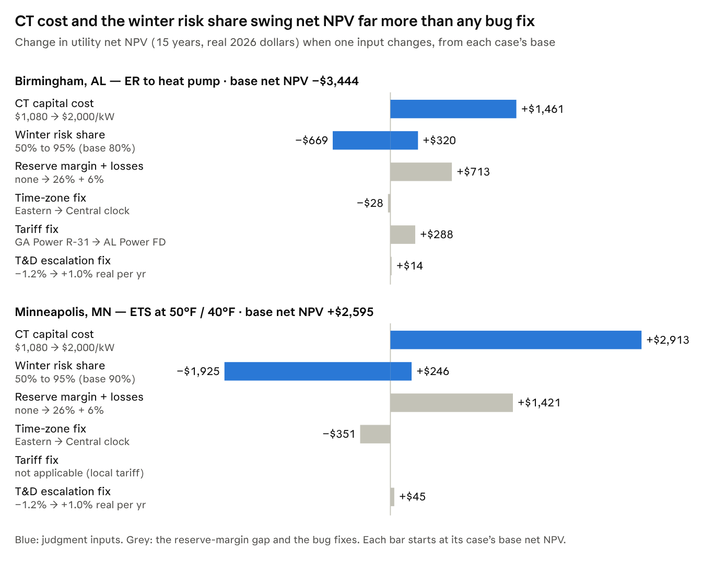
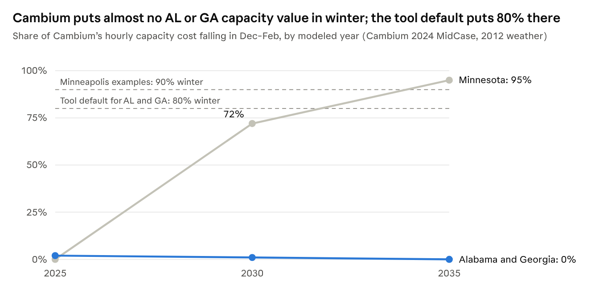

# Southeast Marginal Cost Tool — Methodology Review

November 20, 2026 · Prepared for John Bush and Justin Hill

The engine's math is sound and consistently implemented: an independent recomputation from the raw Cambium files matched its lifetime NPV, TRC and RIM to the cent for both spot-check cases. Results are driven far more by a few judgment inputs than by the math. The winter/summer capacity-risk split, the CT capital cost, and the missing reserve-margin gross-up each move net NPV more than any bug found. Four correctness fixes are worth making before the tool is shown outside the team. The architecture is portable to other utilities once every assumption carries its source.

To reproduce every number in this review, run `python docs/reviews/review_spotcheck.py` from the repository root (see [Reproducing these results](#reproducing-these-results)).

## What holds up

The calculation engine does what it says. I re-ran two example buildings through the tool's own functions, then recomputed every year of the lifetime cash flow by hand from the raw Cambium files; the two agreed to within a millionth of a dollar.

| Spot-check case | Grid benefit NPV | Lost revenue NPV | Utility net NPV | TRC | RIM | PCT | Simple payback |
| --- | --- | --- | --- | --- | --- | --- | --- |
| Birmingham, AL — electric resistance to heat pump | \$3,740 | \$6,584 | −\$3,444 | 1.21 | 0.52 | 2.36 | 3.8 yr |
| Minneapolis, MN — ETS at 50°F / 40°F | \$3,466 | \$271 | +\$2,595 | 1.12 | 3.98 | 0.26 | 93 yr |

Both runs use the tool's defaults: Cambium MidCase, 2030 planning year, 15-year life from 2026, 7% nominal WACC, real 2026 dollars, mid-year discounting, \$3,000 measure cost, \$500 incentive, \$100 admin, and the SERC composite capacity value (\$135.53/kW-yr in 2026\$). These figures are before any of the fixes below.

Verified correct:

- **Hourly value stack.** Energy, generation capacity, transmission, distribution and emissions are summed per hour, with each capacity component spread by a weight vector that sums to 1. A kW reduction earns \$/kW-yr times its weighted coincidence, the standard avoided-cost construction.
- **Cambium ingestion.** The energy price is `energy_cost_enduse`, which already includes marginal losses. It matched the raw files exactly, and the files' stated 2023\$ basis is correctly inflated to 2026\$.
- **Financial math.** The Fisher real/nominal conversion, mid-year timing and real-vs-nominal equivalence all check out.
- **Cost tests.** TRC, PCT and RIM follow the California Standard Practice Manual, including treating the incentive as a transfer that cancels in TRC.
- **Retail billing.** Tiers, time-of-use periods, demand charges and the ratchet are sound for screening.
- **CT carrying cost.** Each benchmark computes as labeled; for example, \$1,110/kW × 10.2% + \$28 = \$141.22/kW-yr, and the SERC composite reproduces \$129.76/kW-yr.
- **Test suite.** All 331 tests pass.

## Fixes that change results

Seven implementation issues alter numbers the tool shows; the first four should be fixed before anyone outside the team sees results. Effects are on the two spot-check cases above.

| # | Issue | Where | Effect on spot checks | Fix | When |
| --- | --- | --- | --- | --- | --- |
| 1 | Capacity weights stay on Eastern time for Central-time states (AL, MN, TN, MS), so peak risk is applied one hour late: AL's 6 AM winter peak is credited at 7 AM | `app.py:1124` hardcodes a −5 offset, passed at `app.py:1842` | MN net NPV overstated by \$351 (14%); Birmingham by \$28 | Pass the state's own offset from `STATE_TIMEZONE_METADATA` | Before sharing |
| 2 | NPV waterfall bridge does not end at the reported NPV. Steps use hardcoded 1% escalation and degradation, the mid-year path has no closing step, and "Residual" is hardcoded to 0 | `calculations.py:2797–2834` | Bridge ends \$324 off (Birmingham) and \$495 off (MN) | Build each step by re-running the engine with one setting changed; add a reconciliation bar | Before sharing |
| 3 | Emissions use the average emission rate of generation, not a marginal rate. No mapped name matches Cambium 2024 headers, so the fallback grabs the first "co2" column, `aer_gen_co2_c`; a test locks this in | `data_loaders.py:694–727`; `tests/test_cambium_downloader.py:251` | Birmingham avoided CO₂ is 1.09 t/yr vs. 1.87 t/yr on the long-run marginal rate (LRMER) and 3.52 t/yr short-run (SRMER). No dollar effect at the \$0 carbon default | Map `lrmer_co2e` by default; offer SRMER as a toggle | Before sharing |
| 4 | Examples without a locked tariff default to Georgia Power R-31, so Birmingham examples are billed on a Georgia rate | `app.py:1320` | Birmingham lost revenue \$653 vs. \$624 on Alabama Power FD; net NPV −\$3,444 vs. −\$3,156; RIM 0.52 vs. 0.54 | Default the tariff from the example's state | Before sharing |
| 5 | Year-1 figures on the Scorecard and Cost-Effectiveness Table use 2030 prices in 2023\$; the lifetime NPV uses interpolated 2026 prices in 2026\$ | `app.py:2024–2043` | Birmingham year-1 energy savings show \$131 in the tables vs. \$161 in year 1 of the cash flow | Drive the annual panels from cash-flow year 1 | Next pass |
| 6 | "Extreme Winter" and "Extreme Summer" multiply real Cambium prices by random 2.2–3.5× factors in fixed hour blocks (Jan–Feb only, and one hour early) | `data_loaders.py:1053–1083` | Not part of the defaults; any result from these cases is synthetic | Relabel as a price stress test, or replace with real alternate weather years | Next pass |
| 7 | T&D values fall 1.2%/yr in real terms. The UI and config call the 1.0% escalator inflation or "real"; the engine treats it as nominal | `config.py:158`; `calculations.py:2221–2225` | +\$14 (Birmingham), +\$45 (MN) if corrected to 1% real | Decide real vs. nominal and label to match | Next pass |

Line numbers refer to commit `7bc3eff`.

## Which assumptions matter most



*Review spot-check runs · branch 8_26_Updates at 7bc3eff · Cambium 2024 MidCase, 2012 weather*

The two inputs a user sets by judgment, CT cost and winter share, dominate; of the bug fixes only the time-zone fix matters, and only for MN. The upper settings are stress tests, not recommendations: \$2,000/kW tracks recently reported combined-cycle costs, and 26% is Georgia Power's reported winter reserve margin.

## The seasonal split



*Computed from the bundled Cambium 2024 MidCase hourly files: load-weighted capacity_cost_enduse, AL (p89, p90), GA (p94), MN (p42–p44, p68)*

The default capacity method finds the right kind of hours from Cambium's net load, then overrides their seasonal share with the slider. For Alabama and Georgia, Cambium's own allocation (its peak hours fall at 5–7 PM in late June and July) and Southern Company's planning (a winter reserve margin above the summer one, implying winter binds) point opposite ways. The tool sides with the utility without saying so.

Neither is obviously right. Cambium's view rests on one mild winter, while utility reliability studies weigh many weather years, including severe cold. The default should cite a source, and the app should show Cambium's split beside it. Cambium's capacity cost level is a useful cross-check too: about \$147/kW-yr for AL in 2030 (2023\$, reserve margin and losses included), against the tool's \$135.53/kW-yr (2026\$, neither included). For Minnesota, a fixed 90% suits the later years of a 15-year life but not the first.

## Gaps in the approach

The larger risks are in what the method leaves out, not in how it computes what it includes. In rough order of consequence:

- **No reserve-margin or loss gross-up on capacity.** A kW avoided at the meter avoids about (1 + reserve margin) × (1 + losses) kW of generation; the tool credits exactly 1. Adding a 15% reserve margin and 6% losses raises net NPV by \$465 for Birmingham and \$928 for MN; at a 26% winter margin, the figure reported for Georgia Power's 2025 IRP, the gains are \$713 and \$1,421. A `reserve_margin_factor` parameter exists in `calculate_annual_capacity_savings` but the app never passes it.
- **The winter/summer split is an input, not a result.** The default capacity method finds peak hours from Cambium data but forces their share of value to a user setting (80% winter by default, 90% for MN). That setting moves results more than any bug; see [The seasonal split](#the-seasonal-split).
- **One mild weather year.** Cambium offers only 2012 weather. Birmingham's 2012 file has a coldest hour of 19.9°F and a single hour below 20°F. Heat pump backup and storage measures are being valued on a winter with almost no severe cold, and without events like Winter Storm Uri (2021) or Elliott (2022).
- **Peak hours are frozen for the asset's life.** Energy prices change every year through 2040, but capacity and T&D weights come from 2030 alone. Cambium's own data shows MN's winter share of capacity cost moving from 0% in 2025 to 95% in 2035.
- **Full CT cost from year 1.** Capacity is credited at full new-CT cost starting in 2026, with no year before which the utility has no capacity need. That may suit today's short Southeast systems, but it should be a stated, adjustable assumption.
- **T&D credit applies to every kW, everywhere.** Each kW reduction earns \$36/kW-yr (\$14 transmission + \$22 distribution) regardless of location. Published work finds distribution deferral value concentrated on the minority of feeders needing upgrades and small when averaged system-wide. I could not trace the "LBNL Southeast Regional Average" preset to a specific LBNL publication. Distribution weights come from the single home's own load profile, and transmission weights from the 100 highest energy-price hours rather than transmission loading.
- **Missing tests and benefit streams.** There is no Utility Cost Test (also called the Program Administrator Cost Test), which many states use as a primary screen, and no Societal Cost Test. Gas-to-electric fuel switching cannot be valued because avoided gas or propane costs are absent. The participant test omits federal tax credits and financing.
- **Small-load assumption.** Value is linear in kW and peak hours are taken as fixed, which holds for one home but not at program scale. The MN ETS case adds up to 18 kW per home overnight; enough adoption would move the system peak into the charging window.

## Repeating it for other utilities

The engine generalizes; the inputs do not yet. Its backbone is national data (NREL Cambium for all lower-48 regions, the Utility Rate Database, NREL's Annual Technology Baseline, BEopt/EnergyPlus loads), so the pipeline already runs outside the Southeast; the Minneapolis examples prove it. What does not travel is the assumption layer, which is Southeast-specific and partly hardcoded.

| Component | Travels as-is? | Southeast-specific today | What each new utility supplies |
| --- | --- | --- | --- |
| Energy prices and emissions | Yes | Nothing | Nothing, or its own production-cost marginal costs |
| Capacity risk hours | Mostly; the Cambium net-load method runs anywhere | Dual-peak windows fixed at Dec–Feb 6–9 AM and Jun–Sep 2–6 PM; 80% winter default | Seasonal and hourly risk from its IRP reliability study, or its RTO's seasonal accreditation |
| Capacity cost | Formula yes | Southeast CT benchmarks; other states (MN) silently fall back to the SERC composite, \$129.76/kW-yr | Its avoided capacity cost: IRP new-CT cost, or capacity auction forecasts in an RTO market |
| T&D deferral | Formula yes | Southeast presets of unverified provenance | A marginal T&D cost study, ideally locational |
| Retail tariffs | Yes, via the URDB lookup | Packaged tariffs are Southeast plus Dakota Electric | Its tariff's URDB label |
| Building loads and weather | Yes | Example homes in Birmingham, Atlanta, Minneapolis | Representative building models and weather files for its climate |
| Cost tests and discount rates | Yes | TRC, PCT, RIM only | The tests its regulator requires, and its discount rates |

Two structural differences need design work, not just new numbers. In RTO markets (MISO, PJM) avoided capacity is a market price, not the cost of a utility-built CT. Distribution co-ops like Dakota Electric avoid their wholesale supplier's demand charges, a different capacity signal from either.

## Recommended improvements

The highest-value next step is making the seasonal split and capacity cost evidence-based and sourced; the bug fixes are small by comparison. In priority order:

1. **Fix the four before-sharing issues** (rows 1–4 above). Add a regression test that recomputes a spot-check case independently, as this review did, so the engine stays verified as it changes.
2. **Ground the seasonal split in evidence.** Use Cambium's own hourly capacity-cost allocation (`capacity_cost_enduse`, already in every downloaded file) as a data-driven default and cross-check. Let a utility override it with seasonal shares from its IRP reliability study, and show the gap when the two disagree.
3. **Gross up capacity for reserve margin and losses,** with seasonal reserve margins per utility. The parameter already exists; it needs a sidebar input and wiring.
4. **Build an assumption registry.** Put every preset (CT costs, fixed charge rates, T&D values, tariffs) in one data file with its source page or docket, vintage, dollar year and a confidence note, and show it in the app. A lab reviewer will ask for this first: several presets cite a docket with no page or derivation, and some could not be traced at all.
5. **Let peak hours change over the life.** Compute capacity and T&D weights for each Cambium milestone year and interpolate them, as the tool already does for prices.
6. **Go beyond one weather year.** Label 2012's mildness now. Later, value winter measures across several real weather years, using the EIA-930 data path the tool already has for 2016–2024, so cold snaps carry their real weight.
7. **Add the Utility Cost Test and a Societal Cost Test,** organized per the National Standard Practice Manual. Add avoided gas or propane costs for fuel switching, and federal tax credits in the participant test.
8. **Add an alternate capacity module** for RTO markets (capacity auction prices) and for a stated year before which there is no capacity need.
9. **Add a program-scale check.** Re-find peak hours on Cambium net load plus N homes' load change, to show where per-home value starts to fall.
10. **Prepare the lab handoff.** Keep the engine separate from the Streamlit UI, take one utility-profile input file, and export each run's full inputs and outputs. The Scenario Manager's saved-run detail is a start. Validate against one utility's internal avoided-cost numbers, already a Phase 2 roadmap item.

## Smaller issues

None of these moves the default results much, but each is worth a pass.

| Issue | Where | Note |
| --- | --- | --- |
| Birmingham's only 2012 weather file is the leap-year version (8,784 rows); the loader keeps the first 8,760, so AL temperatures from March 1 on are one day off | `data_loaders.py:783–796` | Affects weather diagnostics and temperature-based capacity methods, not the default Cambium method. Add a non-leap file or drop Feb 29 in the loader |
| States with several Cambium regions average their prices with equal weights (AL: 2 regions, MN: 4) | `data_loaders.py:991` | The capacity path already weights by load; use the same weighting |
| Multi-state runs (e.g. GA + AL) average hours across time zones without aligning them | `data_loaders.py:991` | Align to one clock first, as the capacity path does |
| Weather comes from the first selected state only | `data_loaders.py:1028` | Fine for one state; surprising for portfolios |
| `ORGANIZATION_PRESETS` is unused, and its capacity values disagree with the presets it names (Southern Company \$105.72 vs. \$141.22/kW-yr) | `config.py:847` | Delete or reconcile before a reviewer finds it |
| The demand ratchet looks at all other months, not the preceding 11 | `billing.py:533` | Fine for an annual steady state |
| The annual energy explanation table defaults to 4,492.86 kWh and 1% degradation | `calculations.py:2517–2519` | Those are the Birmingham case's values; pass the real ones |
| Gross CT cost is credited with no energy-margin offset while Cambium energy value is credited separately | `calculations.py:404` | Small overlap in hours where prices exceed the CT's running cost; worth a sentence in the methodology notes |

## Open questions for John and Justin

- [ ] What should the default winter share be for Southern Company systems, and from what source? Cambium puts about 99% of AL/GA capacity cost in summer; the 80% winter default reflects utility planning. Can Justin share the seasonal reliability-risk split from the IRP?
- [ ] What avoided CT cost should anchor Georgia and Alabama Power? Georgia Power's IRP cost tables are redacted, and it withheld the Yates Units 8–10 price. PSC staff said that cost was likely to approach or exceed \$1 billion for 1,300 MW.
- [ ] Where did the T&D presets come from ("LBNL Southeast Regional Average", the rate-case benchmarks)? Should T&D credit be on by default, or only when a constrained feeder is named?
- [ ] Which cost tests do the intended audiences require: Georgia PSC, Alabama PSC, or a lab partner?
- [ ] Should the tool value gas-to-electric fuel switching? If so, avoided gas and propane costs are a new input stream.

## Reproducing these results

`docs/reviews/review_spotcheck.py` re-runs both spot-check cases through the tool's own modules, recomputes the lifetime NPV independently from first principles, and runs every sensitivity in the tornado chart. From the repository root:

```
python docs/reviews/review_spotcheck.py > spotcheck_results.json
```

It needs the Cambium 2024 MidCase files for AL (p89, p90) and MN (p42–p44, p68) for 2025–2045 in `Cambium_Hourly_Data_raw/`, plus the example load profiles. The seasonal-split chart's figures come from the `capacity_cost_enduse` column of the same Cambium files.

## Sources

All spot-check figures come from the repository on branch `8_26_Updates` at commit `7bc3eff`, run against the bundled Cambium 2024 MidCase files and 2012 weather files.

Pages opened:

- [Georgia Public Service Commission approves plan to meet the energy needs of a growing Georgia](https://www.georgiapower.com/news-hub/press-releases/georgia-public-service-commission-approves-plan-to-meet-the-energy-needs-of-a-growing-georgia.html) — Georgia Power, July 2025. Confirms approval and that reserve margins were at issue; it does not state the margin.
- [Regulators clear path for Georgia Power's new oil and gas units at Plant Yates](https://ajc.com/news/business/regulators-clear-path-for-georgia-powers-new-oil-and-gas-units-at-plant-yates/EWOIOLVHENHBLDWELVSIXQUH7A) — AJC, Aug. 2024. Price withheld as a trade secret; PSC staff estimate near or above \$1 billion.
- [GridLab op-ed on rising gas plant costs](https://www.utilitydive.com/news/natural-gas-energy-affordability-gridlab/803619/) — Utility Dive opinion by GridLab, Oct. 2025. Recent combined-cycle projects near \$2,000/kW vs. \$1,116–1,427/kW for 2026–2027 plants; no simple-cycle figure.
- [CPUC avoided T&D cost study](https://www.pnnl.gov/publications/cpuc-avoided-transmission-and-distribution-cost-study-support-avoided-cost-calculator) — PNNL, May 2026. A draft research plan with LBNL on a new avoided-T&D method.

Not verified from an opened page; confirm before citing externally:

- Georgia Power's 26% winter and 20% summer target reserve margins, from search summaries of the 2025 IRP docket (Docket 56002).
- NREL's guidance that long-run marginal emission rates suit long-lived changes in load. The [Cambium 2024 documentation](https://www.nrel.gov/docs/fy25osti/93005.pdf) is cited in every Cambium file header, but the NREL site did not load.
- Published estimates that distribution deferral value is small system-wide but \$10–60+/kW-yr on constrained feeders, from search summaries of California studies.
